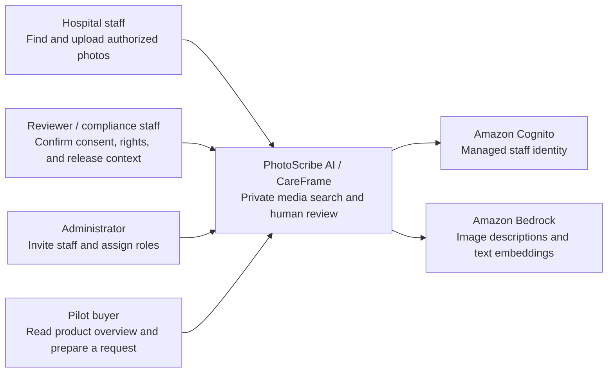
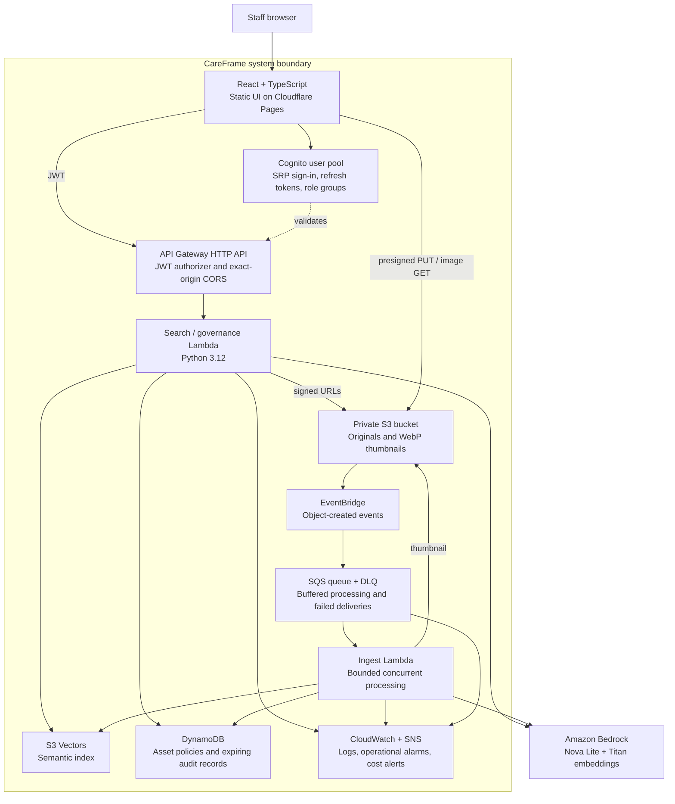
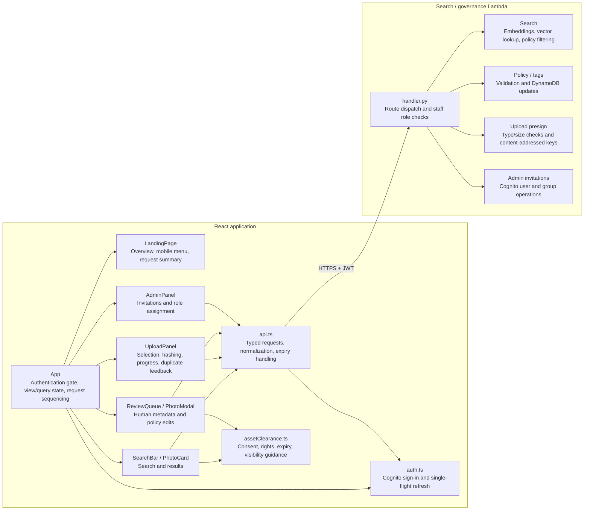

# C4 Architecture

PhotoScribe AI is the system behind the CareFrame interface. These views describe
the single-library managed pilot, not a multi-tenant hospital platform. For
runtime sequences, see [architecture](architecture.md).

## Level 1: System Context

Public visitors receive product content and illustrative photographs only.
Private results and tools require staff sign-in. An approval is a human policy
decision; model-generated descriptions do not establish consent or usage rights.

## Level 2: Containers

GitHub Actions installs and audits the frontend lockfile, tests, builds, and
publishes Pages. Terraform packages and deploys the AWS services from reviewed
saved plans. No AWS deployment credentials are delivered to the browser.

## Level 3: Components

The Lambda diagram shows logical responsibilities in the existing handler, not
new services or modules. Ingest remains a separate Lambda: download original,
generate a best-effort thumbnail, describe, embed, index, and create pending
policy metadata without overwriting human review decisions.

## Trust And Operational Boundaries

- Browser role guards improve navigation; JWT validation and server policy checks
  are authoritative. A hidden button is not an access control.
- Saved role lists are returned with asset metadata and preserved by the editor.
  Approval cannot bypass missing consent, unknown rights, or a missing campaign
  for campaign-limited use.
- Originals, thumbnails, vector data, policies, and model processing live within
  the configured AWS environment. Public illustrative media is separate.
- The deployed pilot keeps its ingest worker enabled. Idle base development
  defaults are not the deployed pilot configuration.
- New accounts use the Cognito temporary-password challenge. This UI does not
  implement complete account listing, revocation, SSO, or customer legal holds.
- Audit TTL is an implementation choice, not an approved hospital retention
  policy. Buyer security, retention, MFA, legal, and regulated-media decisions
  remain explicit [readiness gates](end-user-readiness.md).
